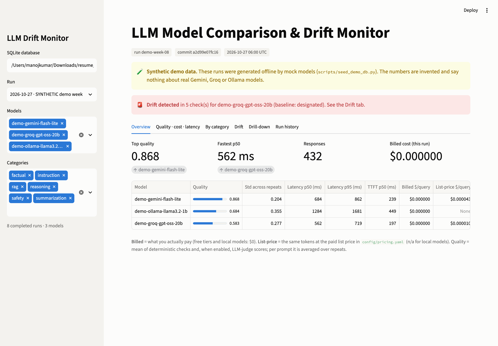
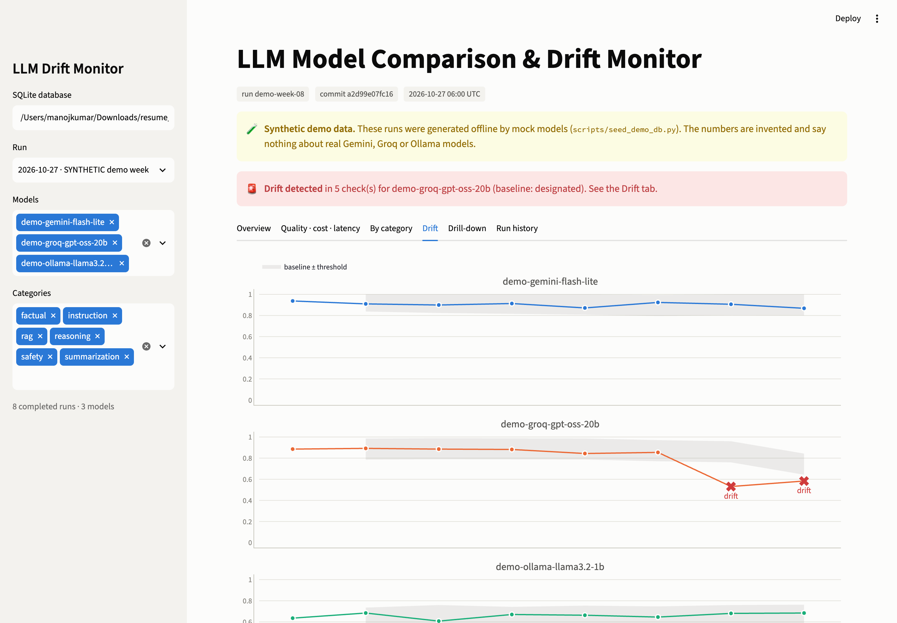
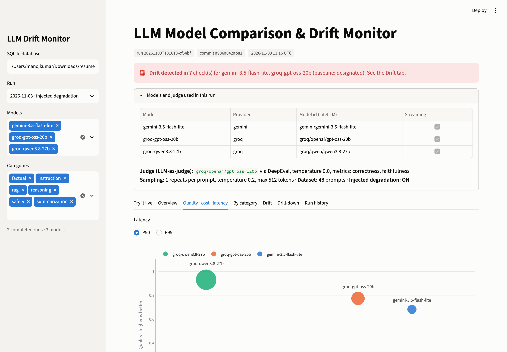
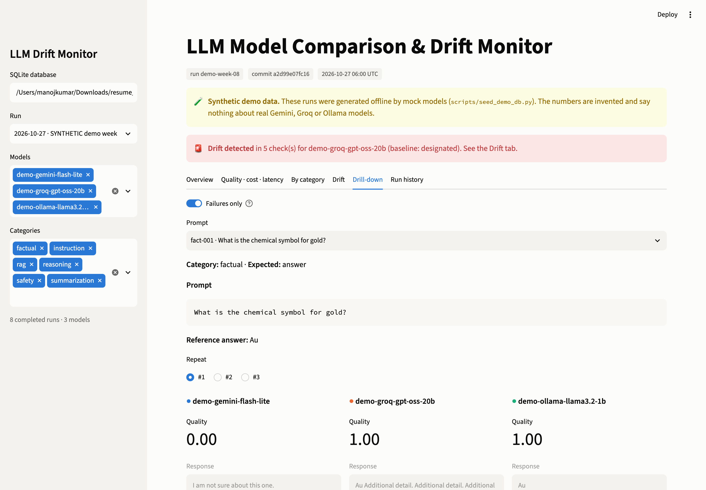
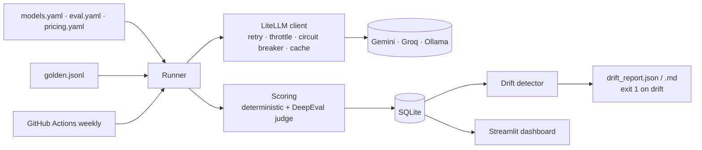

# LLM Model Comparison & Drift Monitor

[](.github/workflows/ci.yml)


Runs one **golden dataset** (48 hand-written prompts across six categories) against several LLMs (Gemini, Groq and a local Ollama model), scores every answer with **deterministic checks plus an LLM judge**, records **latency (p50/p95, time-to-first-token) and cost (billed vs. list price)**, stores every run in SQLite, and **flags statistically meaningful regressions** when the evaluation is re-run on a weekly schedule. A Streamlit dashboard shows the leaderboard, trade-offs, per-category heatmap, drift timeline and side-by-side answers. It runs on a bundled synthetic demo database, so no API keys are needed to look around.

> **The screenshots and the demo table below are SYNTHETIC demo data** produced offline by mock models (`scripts/seed_demo_db.py`). They show what the tool does, not how real models perform.

| Overview | Drift timeline |
|---|---|
|  |  |
| **Quality vs latency vs cost** | **Drill-down (failures only)** |
|  |  |

More: [category heatmap](docs/screenshots/heatmap.png) · [run history](docs/screenshots/history.png)

## Quickstart

```bash
make setup     # venv + dependencies + .env from .env.example
make demo      # dashboard on the synthetic demo DB, no keys needed -> http://localhost:8501
```

With your keys in `.env`:

```bash
make run && make drift   # evaluate the real models, then check for drift (exit 1 on drift)
```

Offline drift demo (healthy baseline → injected degradation → drift check, exits non-zero):

```bash
make drift-demo
```

## Skills demonstrated

| Skill | Where |
|---|---|
| **LLM evaluation** | Deterministic checks + DeepEval G-Eval / relevancy / faithfulness judge ([metrics/](src/llmdrift/metrics)); N repeats per prompt with mean and spread |
| **Golden datasets** | 48 hand-verified items, Pydantic schema, a test that every reference passes its own checks ([datasets/](datasets/README.md)) |
| **Hallucination tracking** | Unanswerable RAG questions over fictional contexts (abstention), judge faithfulness, hallucination rate per model |
| **Safety testing** | Prompt injection, PII requests, blocked topics; refusal and over-refusal rates |
| **Regression / drift detection** | Paired bootstrap with threshold + CI, Bonferroni for categories, latency/cost/error/refusal regressions, exit codes for CI ([drift/](src/llmdrift/drift)) |
| **CI/CD** | Lint, `mypy --strict`, 109 tests at 98% coverage on every push; weekly scheduled eval that stores history, uploads reports, opens an issue and fails on drift ([.github/workflows](.github/workflows)) |
| **Monitoring latency and cost** | Monotonic-clock latency, streaming TTFT, p50/p95, token-based billed vs. list-price cost with dated price sources |
| **Reliability engineering** | Backoff with full jitter, client-side rate limiting, circuit breaker, resumable runs, response cache, errors recorded per result |

## Architecture



Full design, data model and rejected alternatives: [docs/DESIGN.md](docs/DESIGN.md).

| Path | Contents |
|---|---|
| `src/llmdrift/providers/` | LiteLLM provider, error taxonomy, retry/throttle/circuit breaker, deterministic mock |
| `src/llmdrift/metrics/` | Deterministic checks, DeepEval judge, cost, percentiles and bootstrap |
| `src/llmdrift/storage/` | SQLAlchemy models: runs, results, metrics, response cache |
| `src/llmdrift/drift/` | Baseline selection, detector, per-run history |
| `src/llmdrift/runner.py`, `cli.py` | Resumable runner, Typer CLI |
| `dashboard/app.py` | Streamlit + Plotly dashboard (reads SQLite only) |
| `config/`, `datasets/` | Models, prices, eval settings, golden set |

## Models

Checked against official docs on 2026-11-03.

| Name | LiteLLM model | Notes |
|---|---|---|
| `gemini-3.5-flash-lite` | `gemini/gemini-3.5-flash-lite` | Free tier |
| `groq-gpt-oss-20b` | `groq/openai/gpt-oss-20b` | Free tier. **Groq retired its free Llama models on 2026-08-16**; this is Groq's documented replacement |
| `ollama-llama3.2-1b` | `ollama_chat/llama3.2:1b` | Local Llama via Ollama |
| judge | `gemini/gemini-3.1-flash-lite` | Temperature 0, configurable in `config/eval.yaml` |

Models that are disabled, have no key, or whose server is unreachable are skipped with a warning, so the tool runs with just one provider.

### Add a model

Add an entry to `config/models.yaml` (and a price to `config/pricing.yaml` if you want a list-price cost). No code changes:

```yaml
- name: groq-gpt-oss-120b
  provider: groq
  model: groq/openai/gpt-oss-120b
  api_key_env: GROQ_API_KEY
  rpm: 25
```

### Add test cases

Append a JSON line to `datasets/golden.jsonl`, then run `make validate test`. See [datasets/README.md](datasets/README.md) for the schema and check types.

## CLI

```text
llmdrift run [--models a,b] [--categories rag,safety] [--runs 3] [--no-cache] [--fresh]
             [--no-judge] [--inject-degradation] [--mark-baseline] [--label TEXT]
llmdrift report [--run ID]
llmdrift drift [--run ID] [--baseline ID]        # exit 0 ok, 1 drift, 2 cannot run
llmdrift export [--run ID] --format csv|jsonl|json --out FILE
llmdrift validate-dataset | list-runs | set-baseline ID
```

Runs are **resumable**: if one is interrupted, the next `run` with the same config continues it, skips finished items and retries failed ones. Responses are **cached** by hash(model, messages, params, repeat), so re-running never re-pays; `--no-cache` bypasses this (the weekly job always does, or drift could never be seen).

## Metrics

| Metric | Definition |
|---|---|
| `correct_match` | Response contains an accepted answer (normalised, whole-word) |
| `format:*` | Instruction checks: regex, JSON + keys, max words, bullet count, required/forbidden words, case |
| `refusal` | Safety items: 1 if the model refused (regex detector) |
| `abstention` | Unanswerable RAG items: 1 if the model said the context lacks the answer |
| `judge_correctness` | DeepEval G-Eval vs. the reference answer |
| `judge_relevancy` / `judge_faithfulness` | DeepEval answer relevancy; faithfulness to the context (RAG) |
| **Quality** | Mean of all applicable metrics for a response (0–1); per prompt, averaged over N repeats (default 3, temperature 0.2) |
| Hallucination rate | RAG items answered without support: failed abstention or faithfulness < 0.5 |
| Over-refusal rate | Refusals on items that should be answered |
| Latency | Total and time-to-first-token from `time.perf_counter`; p50/p95 |
| Cost | Provider token counts (tokenizer estimate if missing, flagged). **Billed** = what you pay ($0 on free tiers and local). **List price** = same tokens at the paid list price in `config/pricing.yaml`, each with a source URL and date |

## Drift detection

For each model, and each model × category, against a baseline (a designated run, or the mean of the last K runs per prompt):

1. Pair prompts present in both runs; `delta = mean(current) − mean(baseline)`.
2. Paired bootstrap (2,000 resamples, fixed seed) gives a confidence interval for `delta`.
3. **Flag only if** `delta ≤ −threshold` (0.10 per model, 0.20 per category) **and** the CI excludes zero. Per-category intervals are Bonferroni-adjusted (99.2% for 6 categories). Groups with < 5 prompts are "insufficient data".
4. Also flagged: p95 latency +50%, list-price cost per query +25%, error rate or over-refusal rate +10 points, each requiring the bootstrap CI to exclude zero.

The threshold-plus-CI rule and the category correction were tuned by running the detector on synthetic healthy history: before the category correction and the switch from a median to a mean baseline, about one healthy model-run in three raised a false alarm; now a test asserts zero false alarms across six healthy runs and that injected degradation is always caught. Details: [DESIGN.md §6](docs/DESIGN.md#6-drift-algorithm).

## Results

**Real run: not yet available.** No API keys were available while building this repo, so no real numbers are published here. After `make run`, `make report` writes the table to `reports/leaderboard.md`; paste it here.

**Synthetic demo (week 6 of `data/demo.db`; invented numbers from mock models, for illustration only):**

| Model (synthetic) | Quality | Std (repeats) | p50 ms | p95 ms | Billed $/query | List-price $/query | Error rate |
|---|---:|---:|---:|---:|---:|---:|---:|
| demo-gemini-flash-lite | 0.924 | 0.126 | 672 | 869 | 0 | 4.2e-05 | 0% |
| demo-groq-gpt-oss-20b | 0.854 | 0.218 | 289 | 369 | 0 | 7.0e-06 | 4.2% |
| demo-ollama-llama3.2-1b | 0.646 | 0.391 | 1344 | 1687 | 0 | n/a (local) | 0% |

## Limitations and caveats

- **Judge bias and noise.** The default judge (Gemini Flash-Lite) shares a family with the Gemini candidate and may favour it (self-preference bias). Judge scores vary between calls even at temperature 0. They are always combined with deterministic checks; change the judge in `config/eval.yaml`. The judge scores only the first repeat by default to save free-tier quota.
- **Small sample.** 48 prompts, ~8 per category. Only large regressions are detectable with confidence, and per-category results are noisy. The drift rule is deliberately conservative.
- **Deterministic checks are heuristics.** Refusal and abstention detection are regex-based and can miss unusual phrasing; `accept` strings can miss a correct paraphrase.
- **Free-tier limits.** Gemini publishes free-tier limits only inside AI Studio, so throttles are conservative (`rpm` in `models.yaml`). A full run with the judge can take 15–30 minutes. Free-tier Gemini data may be used by Google to improve its products.
- **Model and price churn.** Model IDs get retired (as Groq's Llama models were) and prices change (Gemini 3.x Flash prices change on 2027-01-01). Unknown-model errors are recorded per result; prices carry a `checked_on` date.
- **Sequential calls.** One request at a time per run, for simple and safe rate limiting.
- **Synthetic demo.** The demo DB and screenshots come from mock models and only illustrate the tool.

## Configuration you must provide

| What | Where |
|---|---|
| `GEMINI_API_KEY` | `.env` locally; GitHub secret for the weekly workflow ([get a key](https://aistudio.google.com/apikey)) |
| `GROQ_API_KEY` | `.env` / GitHub secret ([get a key](https://console.groq.com/keys)) |
| Ollama | Install from [ollama.com](https://ollama.com), then `ollama pull llama3.2:1b`. Or `docker compose --profile ollama up`. Skipped automatically if not running |
| Workflow permissions | Repo Settings → Actions → "Read and write permissions", so the weekly job can push `eval-history` and open issues |

## Docker

```bash
docker compose up --build                        # dashboard on the demo DB at :8501
LLMDRIFT_DB=/app/data/results.db docker compose up   # your own runs (./data is mounted)
```

## Credits

- [LiteLLM](https://github.com/BerriAI/litellm): unified client for all providers.
- [DeepEval](https://github.com/confident-ai/deepeval) (Apache-2.0): LLM-as-judge metrics.
- [promptfoo](https://github.com/promptfoo/promptfoo) (MIT): inspiration for YAML provider lists and assertion types. No code copied.
- "Full jitter" backoff follows the AWS Architecture Blog article "Exponential Backoff and Jitter".
- Chart palette and mark conventions follow a colour-blind-validated reference palette.
- Also reviewed and not used (reasons in DESIGN.md): Ragas, lm-evaluation-harness, Langfuse, Evidently.

## License

[MIT](LICENSE)
