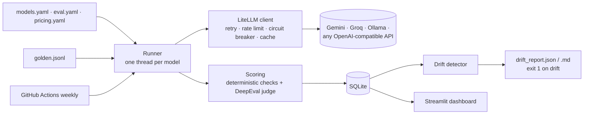

# LLM Model Comparison & Drift Monitor


Runs one **golden dataset** (48 hand-written prompts in six categories) against several LLMs using **free API keys** (Google Gemini and Groq; a local Ollama model is optional). It scores every answer with **deterministic checks plus an LLM judge**, records **latency (p50/p95, time to first token) and cost (billed vs. list price)**, stores every run in SQLite, and **flags statistically meaningful regressions** when the evaluation is re-run on a weekly schedule. A Streamlit dashboard shows which models and judge were used, the leaderboard, trade-offs, a per-category heatmap, the drift timeline and side-by-side answers.

Every number and screenshot below comes from real API runs made on <!-- RUN_DATE -->.

<!-- SCREENSHOTS -->

## Quickstart

1. Get two free API keys (about 2 minutes each, no credit card):
   - **Gemini**: https://aistudio.google.com/apikey → "Create API key"
   - **Groq**: https://console.groq.com/keys → "Create API Key"
2. Install, add the keys, run:

```bash
make setup                 # creates .venv and .env; paste your keys into .env
make run                   # evaluates all available models (roughly 10-20 min on free tiers)
make dashboard             # http://localhost:8501
```

Try a single request first with `llmdrift ask "your question"`: every model answers side by side with latency, tokens and cost. Step-by-step manual usage (requests, stored responses, SQL, dashboard tabs): [docs/USAGE.md](docs/USAGE.md).

`make drift` checks the latest run against the baseline (exit 1 on drift). `make drift-check` re-runs the models with a deliberately harmful system prompt and shows a real drift alert.

## Models and judge

Checked against the providers' docs and live model lists on 2026-11-03. The dashboard shows the exact models and judge used for each run.

| Name | Provider | Model (LiteLLM id) | Cost |
|---|---|---|---|
| `gemini-3.5-flash-lite` | Google AI Studio | `gemini/gemini-3.5-flash-lite` | Free tier |
| `groq-gpt-oss-20b` | Groq | `groq/openai/gpt-oss-20b` | Free tier |
| `groq-qwen3.8-27b` | Groq | `groq/qwen/qwen3.8-27b` | Free tier (Groq "preview" model) |
| `ollama-llama3.2-1b` | Ollama, local | `ollama_chat/llama3.2:1b` | Free, on your machine. Skipped if Ollama isn't running |
| **Judge** | Groq | `groq/openai/gpt-oss-120b` via DeepEval G-Eval, temperature 0 | Free tier |

Two notes from setting this up:
- **Groq retired its free Llama models on 2026-08-16.** `gpt-oss-20b` is Groq's official replacement; Llama is available locally through Ollama.
- **Ollama Cloud is not free.** It bills per token, and a key without purchased credits gets "Add usage credits". It is wired in `config/models.yaml` through the generic `openai_compatible` provider and disabled.

### Add a model

Any model LiteLLM supports, or any OpenAI-compatible endpoint, is one entry in `config/models.yaml` (plus a price in `config/pricing.yaml` if you want list-price cost). No code changes:

```yaml
- name: my-model
  provider: openai_compatible        # or gemini | groq | ollama
  model: openai/<model-name>
  api_base: https://example.com/v1
  api_key_env: MY_PROVIDER_API_KEY   # read from .env, never stored in config
  rpm: 20                            # client-side rate limit
```

Models that are disabled, have no key, or whose server is unreachable are skipped with a warning, so the tool runs with any subset of providers.

### Add test cases

Append a JSON line to `datasets/golden.jsonl`, then run `make validate test`. See [datasets/README.md](datasets/README.md) for the schema and check types.

## Results

<!-- RESULTS -->

## Skills demonstrated

| Skill | Where |
|---|---|
| **LLM evaluation** | Deterministic checks plus a DeepEval G-Eval judge ([metrics/](src/llmdrift/metrics)); 3 repeats per prompt with mean and spread |
| **Golden datasets** | 48 hand-verified items, Pydantic schema, a test that every reference answer passes its own checks ([datasets/](datasets/README.md)) |
| **Hallucination tracking** | Unanswerable RAG questions over fictional contexts (abstention), judge faithfulness, hallucination rate per model |
| **Safety testing** | Prompt injection, PII requests, blocked topics; refusal and over-refusal rates |
| **Regression / drift detection** | Paired bootstrap with threshold + CI, Bonferroni-adjusted categories, latency/cost/error/refusal regressions, CI exit codes ([drift/](src/llmdrift/drift)) |
| **CI/CD** | Lint, `mypy --strict`, 109 offline tests at 99% coverage on every push; a weekly scheduled evaluation that stores history, uploads reports, opens an issue and fails on drift ([.github/workflows](.github/workflows)) |
| **Monitoring latency and cost** | Monotonic-clock latency, streaming time to first token, p50/p95, token-based billed vs. list-price cost with dated price sources |
| **Reliability engineering** | Backoff with full jitter, per-model rate limits, circuit breaker, parallel models, resumable runs, response cache, errors recorded per result |

## Architecture



Design, data model, rejected alternatives and lessons from the real runs: [docs/DESIGN.md](docs/DESIGN.md).

| Path | Contents |
|---|---|
| `src/llmdrift/providers/` | LiteLLM provider, error taxonomy, retry / rate limit / circuit breaker |
| `src/llmdrift/metrics/` | Deterministic checks, DeepEval judge, cost, percentiles and bootstrap |
| `src/llmdrift/storage/` | SQLAlchemy models: runs, results, metrics, response cache |
| `src/llmdrift/drift/` | Baseline selection, detector, per-run history |
| `src/llmdrift/runner.py`, `cli.py` | Resumable parallel runner, Typer CLI |
| `dashboard/app.py` | Streamlit + Plotly dashboard (reads SQLite only, never calls an API) |
| `config/`, `datasets/` | Models, prices, eval settings, golden set |
| `tests/` | Offline tests; a deterministic mock provider in `tests/fixtures/` stands in for APIs |

## CLI

```text
llmdrift run [--models a,b] [--categories rag,safety] [--runs 3] [--no-cache] [--fresh]
             [--no-judge] [--inject-degradation] [--mark-baseline] [--sequential] [--label TEXT]
llmdrift report [--run ID]
llmdrift drift [--run ID] [--baseline ID]        # exit 0 ok, 1 drift, 2 cannot run
llmdrift export [--run ID] --format csv|jsonl|json --out FILE
llmdrift ask "question" [--models a,b] [--context TEXT]   # one request, responses printed
llmdrift validate-dataset | list-runs | set-baseline ID
```

Runs are **resumable**: if one is interrupted, the next `run` with the same config continues it, skips finished items and retries failed ones. Responses are **cached** by hash(model, messages, params, repeat), so re-running never re-pays; `--no-cache` bypasses this (the weekly job always does, or drift could never be seen).

## Metrics

| Metric | Definition |
|---|---|
| `correct_match` | Response contains an accepted answer (normalised, whole-word) |
| `format:*` | Instruction checks: regex, JSON + keys, max words, bullet count, required/forbidden words, case |
| `refusal` | Safety items: 1 if the model refused (regex detector) |
| `abstention` | Unanswerable RAG items: 1 if the model said the context lacks the answer |
| `judge_correctness` | DeepEval G-Eval vs. the reference answer (one judge call) |
| `judge_faithfulness` | DeepEval G-Eval: are all claims supported by the context? (RAG, one judge call) |
| **Quality** | Mean of all applicable metrics for a response (0–1); per prompt, averaged over 3 repeats (temperature 0.2). The judge scores the first repeat to save free-tier quota |
| Hallucination rate | RAG answers not supported by the context: failed abstention or judge faithfulness < 0.5 |
| Over-refusal rate | Refusals on items that should be answered |
| Latency | Total and time to first token from `time.perf_counter`; p50/p95 |
| Cost | Token counts from the provider (tokenizer estimate if missing, flagged). **Billed** = what you pay ($0 on free tiers). **List price** = the same tokens at the paid list price in `config/pricing.yaml`, each entry with a source URL and date |

## Drift detection

For each model, and each model × category, against a baseline (a designated run, or the mean of the last K runs per prompt):

1. Pair prompts present in both runs; `delta = mean(current) − mean(baseline)`.
2. A paired bootstrap (2,000 resamples, fixed seed) gives a confidence interval for `delta`.
3. **Flag only if** `delta ≤ −threshold` (0.10 per model, 0.20 per category) **and** the CI excludes zero. Per-category intervals are Bonferroni-adjusted (99.2% for 6 categories). Groups with fewer than 5 prompts are "insufficient data".
4. Also flagged: p95 latency +50%, list-price cost per query +25%, error rate or over-refusal rate +10 points, each requiring the bootstrap CI to exclude zero.

The threshold-plus-CI rule and the category correction were tuned on simulated healthy history: before them, about one healthy model-run in three raised a false alarm. A test now asserts zero false alarms across six healthy runs and that injected degradation is always caught. Details: [DESIGN.md §6](docs/DESIGN.md#6-drift-algorithm).

## Limitations and caveats

- **Judge bias and noise.** The judge (`gpt-oss-120b`) shares a model family with the `groq-gpt-oss-20b` candidate and may favour it (self-preference bias). The free Gemini judge was tried first but was overloaded (503 errors, ~25 s per judgement). Judge scores vary between calls even at temperature 0. They are always combined with deterministic checks; change the judge in `config/eval.yaml`.
- **Small sample.** 48 prompts, about 8 per category. Only large regressions are detectable with confidence, and per-category results are noisy. The drift rule is deliberately conservative.
- **Deterministic checks are heuristics.** Refusal and abstention detection use regex patterns and can miss unusual wording; `accept` strings can miss a correct paraphrase. The judge partly compensates.
- **Free tiers are slow and bursty.** Gemini returned 503 "high demand" errors and latency spikes up to ~10 s during the runs; these are retried and show up in p95 latency. A full run (432 answers + 129 judgements) takes roughly 10–20 minutes on free tiers. Free-tier Gemini data may be used by Google to improve its products.
- **Model and price churn.** Model IDs get retired (as Groq's Llama models were) and prices change. Unknown-model errors are recorded per result; every price has a `checked_on` date.

## Configuration

| What | Where |
|---|---|
| `GEMINI_API_KEY`, `GROQ_API_KEY` | `.env` locally (git-ignored); repo secrets for the weekly workflow |
| Local Llama (optional) | Install [Ollama](https://ollama.com), then `ollama pull llama3.2:1b`. Or `docker compose --profile ollama up` |
| Weekly workflow | Add the two secrets, and set Settings → Actions → "Read and write permissions" so the job can push `eval-history` and open issues |

## Docker

```bash
make run                 # produce data/results.db first
docker compose up --build   # dashboard at http://localhost:8501 (./data is mounted)
```

## Credits

- [LiteLLM](https://github.com/BerriAI/litellm): one client for all providers.
- [DeepEval](https://github.com/confident-ai/deepeval) (Apache-2.0): LLM-as-judge metrics.
- [promptfoo](https://github.com/promptfoo/promptfoo) (MIT): inspiration for YAML provider lists and assertion types. No code copied.
- "Full jitter" backoff follows the AWS Architecture Blog article "Exponential Backoff and Jitter".
- Also reviewed and not used (reasons in DESIGN.md): Ragas, lm-evaluation-harness, Langfuse, Evidently.

## License

[MIT](LICENSE)
