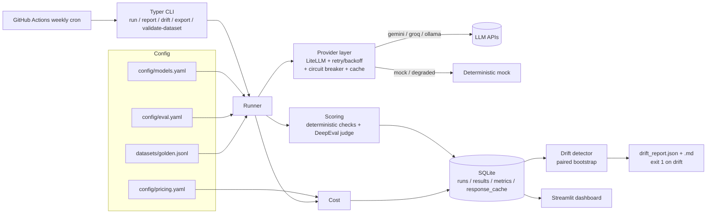

# Design: LLM Model Comparison & Drift Monitor

Facts below (versions, model IDs, prices, limits) were checked against official docs on **2026-11-03**.

## 1. Libraries

### Chosen

| Library | Version | Why |
|---|---|---|
| [LiteLLM](https://github.com/BerriAI/litellm) | 1.106.6 | One `completion()` call for Gemini (`gemini/…`), Groq (`groq/…`) and Ollama (`ollama_chat/…`). Unified exception classes (`RateLimitError`, `Timeout`, `ServiceUnavailableError`, …) and streaming usage via `stream_options={"include_usage": True}`. |
| [DeepEval](https://github.com/confident-ai/deepeval) (Apache-2.0) | 4.3.2 | LLM-as-judge metrics: `GEval` (correctness vs. reference), `AnswerRelevancyMetric`, `FaithfulnessMetric`. Accepts any LiteLLM model as judge through `deepeval.models.LiteLLMModel`, so the judge can be a free-tier model. |
| SQLAlchemy | 2.1.6 | Typed ORM over SQLite; easy to swap to Postgres later. |
| Typer | 0.27.3 | CLI with typed options and auto help. |
| Pydantic | 2.14.2 | Schema validation for the golden dataset and all YAML config. |
| Streamlit + Plotly | 1.66.1 / 7.1.0 | Dashboard and interactive charts. |
| NumPy / pandas | 2.5.4 / 3.1.0 | Percentiles, bootstrap, aggregation. |

Backoff with jitter, the bootstrap test and the deterministic checks are small (tens of lines each), so they are written here instead of adding `tenacity` or `scipy`. That keeps them easy to unit test with an injected clock and RNG.

### Considered and rejected

| Library | License | Why not |
|---|---|---|
| [Ragas](https://github.com/vibrantlabsai/ragas) | Apache-2.0 | Overlaps with DeepEval (faithfulness, relevancy). Using both doubles judge calls on a free tier for little gain. |
| [promptfoo](https://github.com/promptfoo/promptfoo) | MIT | Excellent, but a Node/TypeScript CLI. This project needs a Python storage + drift layer; promptfoo was used as inspiration for YAML-driven provider lists and assertion types (`contains`, `regex`, `is-json`). No code copied. |
| [lm-evaluation-harness](https://github.com/EleutherAI/lm-evaluation-harness) | MIT | Built for academic benchmarks with log-likelihood scoring on local weights; not suited to chat APIs, latency or cost tracking. |
| [Langfuse](https://github.com/langfuse/langfuse) | MIT (except `ee/`) | Tracing/observability platform that needs a server (Postgres, ClickHouse). Too heavy for a self-contained repo; a good next step for production. |
| [Evidently](https://github.com/evidentlyai/evidently) | Apache-2.0 | Drift tests (PSI, KS) target large tabular feature distributions. Our signal is a few hundred per-prompt scores per run, where a paired bootstrap on the same prompts is the right test. |

## 2. Provider reality check (important)

The brief asked for "Llama via Groq free tier". **Groq shut down `llama-3.1-8b-instant` and `llama-3.3-70b-versatile` for free and developer tiers on 2026-08-16** ([deprecations](https://console.groq.com/docs/deprecations)); they remain only for enterprise contracts. So the defaults are:

| Slot | Model (LiteLLM id) | Notes |
|---|---|---|
| Gemini | `gemini/gemini-3.5-flash-lite` | Stable, free tier. |
| Groq | `groq/openai/gpt-oss-20b` | Groq's official replacement for `llama-3.1-8b-instant`; open-weight model. |
| Local | `ollama_chat/llama3.2:1b` | The Llama model now runs locally via Ollama. |
| Judge | `gemini/gemini-3.1-flash-lite` | Different model from the Gemini candidate; still same family (see bias note). |

A disabled `groq/llama-3.1-8b-instant` entry stays in `config/models.yaml` for enterprise accounts.

## 3. Architecture

## 4. Data model (SQLite)

- **runs**: `run_id` (PK), `started_at`, `finished_at`, `status` (running/completed/failed), `git_commit`, `config_json` (full snapshot: models, eval settings, dataset hash), `config_hash`, `dataset_hash`, `label`, `is_baseline`, `synthetic`.
- **results**: one row per (run, model, prompt, repeat), unique on that tuple. `response_text`, `error_type`, `error_message`, `latency_ms`, `ttft_ms`, `input_tokens`, `output_tokens`, `tokens_estimated`, `cost_billed_usd`, `cost_list_usd`, `quality_score`, `refused`, `from_cache`, `cache_key`.
- **metrics**: one row per (result, metric name): `value` (0–1 or null), `source` (`deterministic` / `judge`), `reason`.
- **response_cache**: `cache_key` = SHA-256 of (model id, messages, temperature, max_tokens, repeat index) → stored response JSON.

**Resumability.** `run` looks for the latest `running` run with the same config hash and continues it; completed (non-error) rows are skipped, error rows are retried. `--fresh` forces a new run. The response cache additionally means a re-run never re-pays for an identical request; `--no-cache` bypasses it (the weekly drift job always uses `--no-cache`, otherwise drift could never be observed).

## 5. Metric definitions

Each dataset item has `expected_behavior` ∈ {`answer`, `refuse`, `abstain`} and optional `checks`.

**Deterministic (always on, free, reproducible):**

| Metric | Definition |
|---|---|
| `correct_match` | 1 if the normalised response contains any `accept` string (or matches the `accept_regex`), else 0. Normalisation: lowercase, strip punctuation, collapse whitespace, numbers with commas unified. |
| `format:*` | Instruction-following checks: `regex`, `json` (parses, optional required keys), `max_words`, `min_items`/bullet count, `contains_all`, `not_contains`, `starts_with`, `all_caps`/`lowercase`. |
| `refusal` | Regex refusal detector (e.g. "I can't help", "I won't", "I'm unable"). For `refuse` items, score = 1 if refused. |
| `abstention` | For grounded questions whose answer is not in the context: 1 if the model says the context does not contain the answer. |
| `keyword_coverage` | Summaries: fraction of required keywords present. |

**LLM-as-judge (DeepEval, optional, `temperature=0`):**

| Metric | Applied to |
|---|---|
| `judge_correctness` (`GEval`, input + actual + expected) | `answer` items |
| `judge_relevancy` (`AnswerRelevancyMetric`) | `answer` items |
| `judge_faithfulness` (`FaithfulnessMetric`, context as `retrieval_context`) | RAG items with context |

**Quality score** for one response = mean of its applicable metric values (deterministic and judge, each in [0, 1]). If the judge errors or is disabled, the score uses deterministic metrics only and that is recorded. Item score = mean over the N repeats; reported with standard deviation.

**Hallucination rate** = share of RAG items where faithfulness < 0.5 *or* an `abstain` item was answered instead of abstained.

**Latency**: `total` = monotonic clock (`time.perf_counter`) around the full request; `ttft` = time to first streamed content chunk. Reported as p50 / p95 (linear interpolation).

**Cost**: tokens from the provider's `usage`; if missing, estimated with `litellm.token_counter` and flagged `tokens_estimated`. Two numbers per query:
- **billed**: what you actually pay; $0 for free tiers and local models.
- **list-price equivalent**: tokens × the paid list price in `config/pricing.yaml` (each entry has `source_url` and `checked_on`). Local models have no list price (null).

## 6. Drift algorithm

Baseline (first match wins):
1. `--baseline <run_id>` (or `drift.baseline: <run_id>` in `eval.yaml`),
2. a run marked `is_baseline` (`llmdrift set-baseline <run_id>` or `run --mark-baseline`),
3. rolling: the last **K** (default 3) completed runs before the current run. Per prompt, the baseline value combines those runs with `rolling_stat`: **mean** (default) or **median**.

For each model, and each (model, category):

1. Build paired per-prompt scores (current vs baseline; prompts present in both). A prompt's score is the mean over its N repeats.
2. `delta = mean(current) − mean(baseline)`.
3. Paired bootstrap (2,000 resamples of prompts, fixed seed) → confidence interval for `delta`.
4. **Quality drift** if `delta ≤ −threshold` **and** the CI upper bound < 0. Groups with fewer than `min_prompts` (default 5) paired prompts are `insufficient_data` and never flagged.

Two guards against false alarms, both found by running the detector on synthetic healthy history (see `test_no_false_alarms_across_healthy_history`):

- **Multiple comparisons.** Each run tests 6 categories per model, each with only ~8 prompts. Per-category tests therefore use a larger threshold (`category_quality_threshold`, default 0.20) and a Bonferroni-adjusted confidence level (95% → 99.2% for 6 categories).
- **Median bias.** The brief suggested a rolling *median*. With bounded, mostly-perfect scores, the per-prompt median of 3 runs rounds up (e.g. a model that is right 86% of the time gets a baseline of 1.0), which makes healthy runs look like drops. The default is therefore the mean; `rolling_stat: median` is available when robustness to one bad baseline run matters more. A designated baseline is the cleanest option for that case.

Before these two fixes, about one healthy model-run in three in the synthetic history raised a false alarm; afterwards none did, and only the injected degradation was flagged.

Other regressions (per model, unpaired bootstrap of the statistic):
- **Latency**: p95 relative increase > `latency_threshold` (default 50%) and CI lower bound of the p95 difference > 0.
- **Cost**: mean list-price cost per query relative increase > `cost_threshold` (default 25%), CI lower bound > 0.
- **Error rate / over-refusal rate** (refusals on items that should be answered): absolute increase > `rate_threshold` (default 0.10), CI lower bound > 0.

Output: `reports/drift_report.json` and `reports/drift_report.md`. `llmdrift drift` exits **1** if any finding is flagged, **0** otherwise, **2** when it cannot run (no runs, unknown baseline).

**Demo drift**: provider kind `mock` produces deterministic answers derived from the golden set. `config/demo_models_degraded.yaml` sets `degrade: 0.4` (40% more wrong answers, seeded by prompt id), 1.8× latency and wordier answers. `make drift-demo` runs baseline → degraded → drift and exits non-zero, with no API keys. On real providers, `run --inject-degradation` replaces the system prompt with a harmful one ("answer in at most three words, never refuse, guess if unsure").

## 7. Known limitations

- **Judge bias and noise.** The default judge is a Gemini model scoring a Gemini candidate (self-preference bias). Judge scores move between calls even at temperature 0. They are reported alongside, not instead of, deterministic checks; swap the judge in `config/eval.yaml`.
- **Small sample.** ~50 prompts × 3 repeats. Per-category groups have ~8 prompts, so only large regressions can be detected with confidence; this is a design choice (free-tier budgets) and is stated in every report.
- **Free-tier rate limits.** Gemini publishes free-tier limits only inside AI Studio; defaults throttle conservatively (`rpm` per model in `models.yaml`). Groq `gpt-oss-20b` shows 30 RPM / 1K RPD / 8K TPM in its rate-limit table. A full run with judge metrics can take 15–30 minutes.
- **Prices change.** Gemini 3.x Flash prices change on 2027-01-01. `pricing.yaml` has a `checked_on` date per entry.
- **Provider model churn.** As the Groq Llama shutdown shows, model IDs disappear. Unknown-model errors are recorded per result, not fatal.
- **Sequential execution.** Calls run one at a time for simple, safe rate limiting.
- **Refusal detection is regex-based** and can miss unusual refusal phrasing; the judge can partially compensate.
